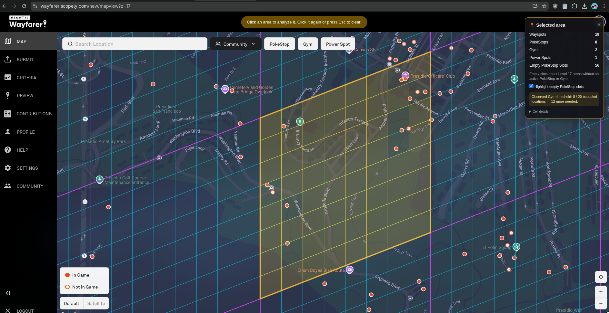

# PokéStop & Gym Planning Grid

A browser extension that overlays **S2 cells (Level 14 & Level 17)** directly on the [Scopely Wayfarer](https://wayfarer.scopely.com/new/mapview) map.



## What are S2 cells?

Niantic uses Google's S2 geometry library to divide the Earth into a hierarchical grid. For Pokémon GO:

- **Level 14** (~10 km²) — determines how many Gyms a zone gets (2 stops = 1 gym, 6 = 2 gyms, 20 = 3 gyms)
- **Level 17** (~300 m²) — only one Pokéstop or Gym can exist per cell

Knowing these boundaries helps you plan Wayfarer nominations strategically.

## Features

- Overlay L14 and L17 cells directly on the Wayfarer map
- Cells update as you pan and zoom
- Customisable colours for each level
- Toggle on/off from the extension popup
- Persists your settings between sessions
- Select an L14 area with **Analyze map area** to inspect its Pokémon GO planning statistics

## Installation

This extension is not on the Chrome Web Store. Install it manually:

1. Download the latest zip from [Releases](../../releases) and unzip it
2. Open Chrome and go to `chrome://extensions`
3. Enable **Developer mode** (top right toggle)
4. Click **Load unpacked** and select the unzipped `s2-extension` folder
5. Navigate to `https://wayfarer.scopely.com/new/mapview`
6. Click the extension icon and toggle **Show planning grid**

## Usage

- Open the extension popup on the Wayfarer mapview
- Toggle **Show planning grid** on
- L14 cells appear at zoom level 8+, L17 cells at zoom level 12+
- Use the colour pickers to customise each level
- Click **Apply changes** after adjusting colours
- Choose **Analyze map area**, then click an L14 area to select it; click it again, press Escape, or close the panel to clear it.

### Area analysis

The selected-area panel is designed to distinguish three different things: **Wayspots** are map records, **PokéStops** and **Gyms** are active Pokémon GO locations, and **Empty PokéStop Slots** are Level 17 areas without an active PokéStop or Gym. Power Spots are counted separately when verified map data provides them.

The Wayfarer map’s `/api/v1/vault/mapview/gcs` response provides verified POIs and active game entities. The extension requests the current viewport and the selected L14 bounds, then uses each POI’s `latE6`/`lngE6` and active `gmo` entity (`POKESTOP`, `GYM`, or `POWERSPOT`) for these metrics. If that endpoint is unavailable, the panel shows values as unavailable rather than guessing.

## How it works

The extension injects a bridge script into the Wayfarer page that reads the embedded Google Maps instance from Angular's component context, then relays the current map bounds to a content script that draws an SVG overlay. All S2 cell geometry is computed locally using a pure JavaScript implementation — no external requests are made.

## Compatibility

- Chrome / Chromium-based browsers (Edge, Brave, etc.)
- Manifest V3
- Tested against the current Mapview route: `wayfarer.scopely.com/new/mapview`

The Wayfarer website is configured in `scripts/wayfarer-config.js`. A future website move requires updating its `host` (and `mapPath` if needed), plus the matching static host entries in `manifest.json`. Chrome manifests are static JSON and cannot import the runtime configuration module.

## Development validation

This project has no build step: Chrome loads the unpacked Manifest V3 files directly. With Node.js 18 or newer installed, run:

```bash
npm run check
```

This runs URL-configuration unit tests and integration checks for the manifest, referenced extension files, script load order, and JavaScript syntax. It cannot verify the authenticated Wayfarer DOM; load the extension through `chrome://extensions` and test the Mapview bridge in a signed-in browser before release.

The full L14 analysis product requirements and best-effort accuracy model are documented in [docs/L14-ANALYSIS-PRD.md](docs/L14-ANALYSIS-PRD.md).

## Privacy & Security

The extension requests only `activeTab` and `storage` permissions. It reads no personal data, makes no network requests of any kind, and stores only your display preferences (colours, toggle state) locally on your device. All S2 geometry is computed entirely in the browser.

## Disclaimer

This is a **read-only, passive visual overlay**. It does not interact with Wayfarer's servers, does not automate any actions, and does not modify any game or review data. Use at your own discretion and in accordance with Wayfarer's Terms of Service.

## License

MIT — see [LICENSE](LICENSE)
